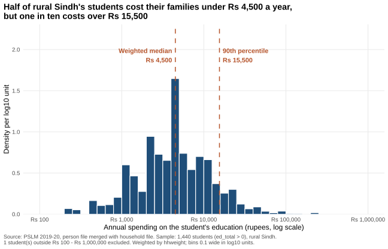
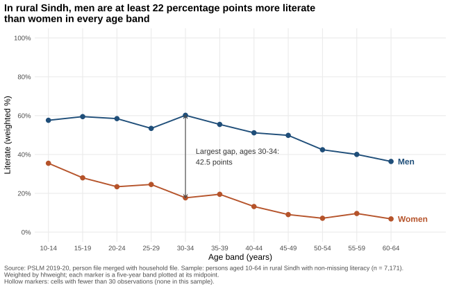

# ECO346-A1-FA24-BEDS-026

ECO346 Data Visualization Techniques for Economists, Assignment 1, Fall 2026 (Section B).
Registration number: FA24-BEDS-026.

## Variant

26 = 3 x 8 + 2, so my **variant is 2: Sindh, rural** (`prov_code == 3`, `urban_rural == 1`).
Only persons in rural Sindh are used. `hhweight`, `prov_code` and `urban_rural` are attached from the household file by `hhid`.

## Repository structure

```
README.md
data/      pslm_person_subset.csv, pslm_hh_subset.csv
scripts/   01_default.R, 02_distribution.R, 03_literacy.R, 04_second_language.py
figures/   default.svg, distribution.svg, literacy_by_age.svg, literacy_by_age_python.svg
tables/    band_table_R.csv, band_table_python.csv
slides/    FA24-BEDS-026.pptx
```

## How to reproduce

A fresh clone reproduces every figure and number with no manual step and no internet connection.
R packages: `ggplot2`, `dplyr`, `svglite`. Python packages: `pandas`, `numpy`, `matplotlib`.

```
Rscript scripts/01_default.R
Rscript scripts/02_distribution.R
Rscript scripts/03_literacy.R
python scripts/04_second_language.py
```

Run them in this order. Script 04 compares its band table with the one written by script 03. Every figure is saved as SVG by the script that draws it.

## The two figures

### Figure 1. The distribution (Question 2)



### Figure 2. The relationship (Question 3)



The default figure of Question 4 is `figures/default.svg`. The Python version of Figure 2 is `figures/literacy_by_age_python.svg`.

## Question 2: the distribution

| Statistic | Value |
|---|---|
| Number of students (`ed_total > 0`) | 1,440 |
| Weighted median | Rs 4,500 |
| Unweighted median | Rs 4,295 |
| Weighted 10th percentile | Rs 1,000 |
| Weighted 90th percentile | Rs 15,500 |
| Ratio p90 / p10 | 15.50 |
| Excluded (outside Rs 100 to Rs 1,000,000) | 1 |

**What the figure shows:** Spending is right-skewed on the log scale: most students cost between Rs 1,000 and Rs 15,500 a year, a 15.5-fold spread. The weighted median (Rs 4,500) is slightly above the unweighted (Rs 4,295). Weights re-balance the sample towards what households represent in the population; the gap is only about 5%, so weighting changes the picture little here.

## Question 3: the relationship

Sample: persons aged 10 to 64 in rural Sindh with `literate` not missing (n = 7,171). Rates are weighted by `hhweight`.

| Band | Women n | Women literate (%) | Men n | Men literate (%) | Gap (points) |
|---|---|---|---|---|---|
| 10-14 | 529 | 35.5 | 718 | 57.6 | 22.1 |
| 15-19 | 446 | 28.0 | 548 | 59.5 | 31.5 |
| 20-24 | 455 | 23.4 | 422 | 58.5 | 35.1 |
| 25-29 | 430 | 24.6 | 419 | 53.4 | 28.8 |
| 30-34 | 399 | 17.7 | 382 | 60.2 | 42.5 |
| 35-39 | 319 | 19.5 | 391 | 55.5 | 36.0 |
| 40-44 | 285 | 13.2 | 274 | 51.2 | 38.0 |
| 45-49 | 198 | 9.1 | 221 | 49.9 | 40.8 |
| 50-54 | 152 | 7.2 | 208 | 42.4 | 35.2 |
| 55-59 | 98 | 9.6 | 100 | 40.0 | 30.4 |
| 60-64 | 77 | 6.8 | 100 | 36.4 | 29.6 |

No band has fewer than 30 observations for either sex, so no marker is hollow.

- Women aged 15-19: **28.0%**. Men aged 15-19: **59.5%**.
- Women aged 55-59: **9.6%**. Men aged 55-59: **40.0%**.
- Largest gap: **ages 30-34, 42.5 points**.

**Interpretation:** Literacy falls with age for both sexes, as older cohorts had less access to schooling, and women start far lower: the gap is 22 to 43 points in every band and is widest at 30-34. Even among teenagers, women's literacy is 28.0% against 59.5% for men. What the figure cannot tell us is whether the decline reflects ageing or cohort differences: one cross-section cannot separate how people change over life from how generations differ, nor why the gap exists.

## Question 4: the makeover

The default figure (`figures/default.svg`, plain `ggplot(data, aes(x, y)) + geom_point()`) was committed before its redesign (`figures/literacy_by_age.svg`).

**Explanation of the redesign:**
1. **Conditional means instead of raw points.** The default plots 7,171 zeros and ones on two horizontal lines, so points overlap (overplotting) and no pattern is visible. Weighted literacy rates per age band show the trend.
2. **Position on a common scale, direct labels.** Women and men are two lines on one 0-100% axis, labelled at their ends, so no legend lookup is needed (perceptual ranking of channels).
3. **Data-ink.** The grey panel, heavy grid and default axis titles are removed. A finding title, a source caption, an annotated largest gap and a hollow-marker rule for thin cells are added.

**What the default shows that the redesign hides:** single years of age and each person's own 0/1 outcome, so you can see how many people sit at each age. Five-year bands hide that.

## Question 5: a second language (Python)

The band table and figure are recomputed in `scripts/04_second_language.py`. The script compares its table with `tables/band_table_R.csv` and prints the largest difference. The two tables agree to one decimal place.

Literacy rate of women aged 15-19: **R 28.0, Python 28.0**.

**One default that differed:** ggplot pads each axis by 5% beyond its limits, while matplotlib does not apply the same padding when limits are set. I set the y limits to -5 and 105 by hand, and fixed the x limits, ticks and labels, so the two figures match. I also formed the age bands by integer division in both languages, since `pd.cut` closes its intervals on the right by default.

## Definitions used

- Weighted mean: sum(w x) / sum(w), with `w = hhweight`.
- Weighted p-th quantile: sort by x, take the cumulative share of weight, and use the smallest x at which the share reaches or exceeds p. R's built-in `quantile()` is not used.
- Age bands are five years wide (10-14, ..., 60-64), plotted at their midpoints (12, 17, ..., 62). A band with fewer than 30 unweighted observations is thin.
- Rupees are rounded to the nearest whole rupee and percentages to one decimal.
